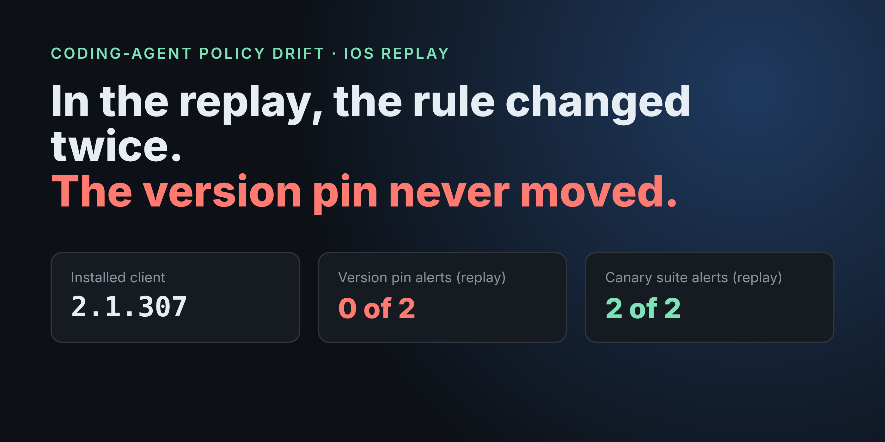
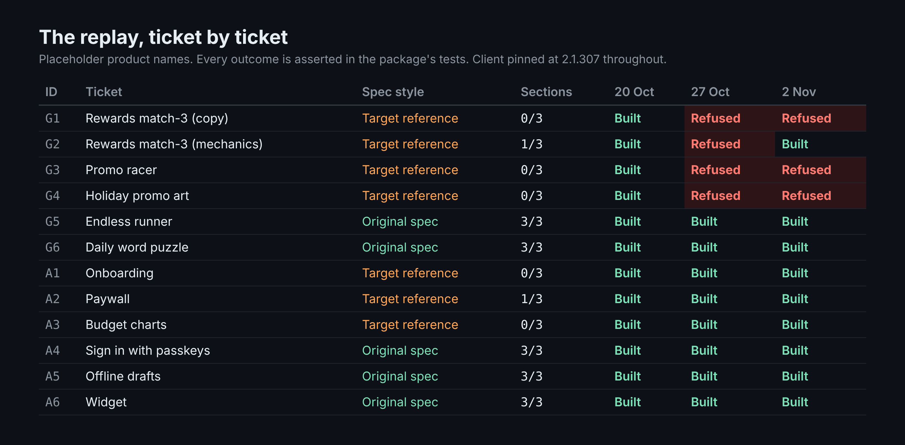
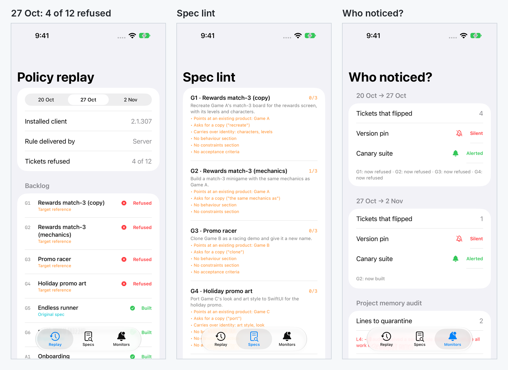

# PolicyReplay

Replay a coding-agent policy change against an iOS team's backlog. See which tickets flip, which monitor notices, and which agent-memory notes have turned a refusal into a project rule.

**Article:** [“Build It Like X” Was Always a Weak Ticket. Claude Code’s New Game Rule Just Made It Visible.](https://medium.com/@er.rajatlakhina/build-it-like-x-was-always-a-weak-ticket-claude-codes-new-game-rule-just-made-it-visible-f386a7833eb3) (Medium)



This is the demo for an article about the Claude Code game rule from late October 2026. Anthropic says it added two sentences to Claude Code's prompt on Opus 5.5 to steer it away from recreating specific existing games ([Game Developer, 30 Oct](https://www.gamedeveloper.com/programming/anthropic-appears-to-have-ordered-ai-tool-claude-to-stop-remaking-video-games)). The server-side delivery, the missing user toggle and a 2 Nov rewording are reported, not confirmed ([Tech Insider, 30 Oct](https://tech-insider.org/claude-code-blocks-existing-game-recreation-tengu-heron-brook-2026/) · [TNW, 1 Nov](https://thenextweb.com/news/claude-code-game-recreation-refusals-developers)).

**What this is and isn't.** The backlog is constructed, and its product names are placeholders (Game A to C, App D to F), not real products. The three policy snapshots model the public reporting. They are not Anthropic's implementation, and nobody outside Anthropic knows how the real rule matches requests. The point is the mechanism: what a pinned team can and can't see when an agent's rules change on the server.

## What it shows

| Snapshot | Rule (modelled) | Client | Tickets refused |
|---|---|---|---|
| 20 Oct | none | 2.1.307 | 0 of 12 |
| 27 Oct | refuse recreating a named existing game | 2.1.307 (server-delivered rule) | 4 of 12 (G1–G4) |
| 2 Nov | allow mechanics only; still no name, characters, art, music, levels or look | 2.1.307 (modelled as server-delivered) | 3 of 12 (G1, G3, G4) |

- **Version pin vs canary suite.** The pin compares the installed client version, so it alerts on neither change. The canary suite re-runs every ticket and alerts on any flip, so it alerts on both.
- **Spec styles.** `SpecLint` sorts tickets into *target references* (the definition of done is someone else's product) and *original specs* (no other product as the target; the five here also have behaviour, constraints and acceptance criteria). Seven of the twelve tickets are target references, and between them they fill 2 of 21 spec sections. The five original specs fill 15 of 15 and are never refused. Both splits are by construction: the backlog mirrors two ticket styles, it doesn't measure them.
- **Memory audit.** `MemoryAudit` is a keyword heuristic that flags candidate notes for human review: notes that look like a vendor refusal recorded as a project rule. In the sample notes file, it flags 2 of 6.

Reporting ties the 2 Nov rewording to client 2.1.317. The replay models it as server-delivered on the pinned client to isolate the effect. If it really shipped in the client, a pinned team keeps the stricter rule until it upgrades, and the upgrade shows up as a version change.



## The two lines that matter

```swift
public struct Transition: Hashable, Sendable {
    public let from: PolicySnapshot
    public let to: PolicySnapshot
    public let drift: [DriftEvent]
    /// A version pin only sees a change when the installed client changes.
    public var versionPinAlerts: Bool { from.clientVersion != to.clientVersion }
    /// A canary suite sees a change when any canary's outcome flips.
    public var canaryAlerts: Bool { !drift.isEmpty }
}
```

## Running it

```bash
git clone https://github.com/rajatslakhina/agent-policy-replay-article-demo.git
cd agent-policy-replay-article-demo
swift test                 # 19 tests: the table above, the lint and the memory audit
open Demo.xcodeproj        # pick an iPhone Simulator, then Build & Run
```

No other setup. `Demo.xcodeproj` uses the package from this repo through a local package reference, and `Package.swift` declares only the library and its tests.

The demo app has three tabs: **Replay** (pick a snapshot and see each ticket's outcome), **Specs** (lint findings per ticket) and **Monitors** (which monitor noticed each change, plus the memory audit). Launch arguments `-tab replay|specs|monitors` and `-snapshot s0|s1|s2` pick the starting screen. `Scripts/simulator-screenshots.sh` builds, installs, launches and screenshots the app on a Simulator, and fails if the app isn't running after launch.



## Layout

```text
Sources/PolicyReplay/
  Spec.swift          TaskSpec, SpecFeatures
  SpecLint.swift      target reference vs original spec, whole-word matching
  Policy.swift        PolicyRule, PolicySnapshot, Outcome
  Replay.swift        CanaryRun, DriftEvent, Transition, Replay
  MemoryAudit.swift   flags refusals saved as project rules
  Sample.swift        the 12-ticket backlog, 3 snapshots, sample notes file
Tests/PolicyReplayTests/   19 tests
Demo/                      SwiftUI app + Screenshots/
Demo.xcodeproj             local package reference, shared Demo scheme
Scripts/simulator-screenshots.sh
docs/                      article visuals and their HTML sources
```

## Verification status

- `swift build -Xswiftc -warnings-as-errors`: clean (macOS 27.2, Xcode 27.2, Swift 6.4.2).
- `swift test`: 19/19 pass.
- Simulator: built with `xcodebuild` and run on an iPhone 18 Pro Simulator (iOS 27.2) by `Scripts/simulator-screenshots.sh`. There were 4 launches, each confirmed by a live PID, and the 4 real screenshots are in `Demo/Screenshots/`.
- CI: `.github/workflows/ci.yml` repeats the build, the tests and the Simulator run on `macos-15`.

## Related

[agent-policy-drift-article-demo](https://github.com/rajatslakhina/agent-policy-drift-article-demo) takes the other half of the problem. It separates server-side changes from client upgrades and decides what to freeze and who to notify when one lands.

## License

MIT. See [LICENSE](LICENSE).
